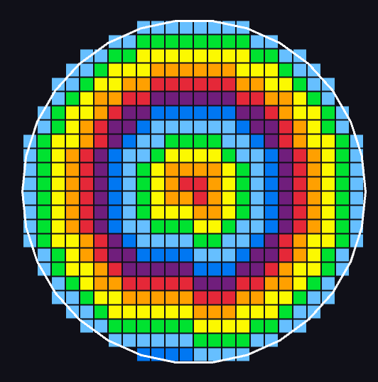

# Circle Spiral (Quadro-Circular Smart Pointer) 🦀🏆

An elegant, memoryless \(O(1)\) geometric iterator written in Rust that generates an **ideally dense, mirror-symmetric discrete circle (smoothed octagon)** using a continuous square spiral traversal.

## 🧠 The Mathematical Breakthrough

In discrete mathematics and game development, drawing a solid circular perimeter usually requires pixel-sieving (like the Midpoint/Bresenham algorithm) backed by spatial hash-maps (`HashSet`) to avoid infinite loops and duplicate tiles.

This project proves that a **blind, 1-step-ahead smart pointer** can perfectly orbit the Gauss circle without storing any history. By combining a 5-way radar, **midpoint smoothing sieve (\(r^2 + r\))**, and a dynamic one-way pressure valve (`old_limit`), the emergent system completely eliminates holes, zig-zags, and isolated diagonal vertices.

### 📈 Scale & Precision Achievements

- **468 steps:** Perfect boundary alignment at \(R=12\).
- **1,000,000 steps:** Smooth transition at layer \(R=563\) (\(\pi \approx 3.15\)).
- **10,000,000 steps:** Flawless scaling up to layer \(R=1782\), extracting \(\pi \approx 3.1490\) solely from integer grid properties!

## 🧬 Unique Perimeter Sequence

The algorithm produces a completely unique, highly optimized arithmetic progression of ring perimeters (tile counts per layer) hidden from standard OEIS databases due to the even \(2\times2\) coordinate origin:
\[4 \to 12 \to 16 \to 20 \to 36 \to 32 \to 44 \dots\]

## 🚀 Features

- **Zero-Memory Footprint (\(O(1)\)):** No vector buffers, no hash lookups. Runs at the speed of light.
- **100% Solid Connectivity:** No isolated single vertices.
- **Visual Diagnostics:** Built-in Macroquad step-by-step rendering utilizing 4-tile packet synchronization and color-coded radius visualization.
